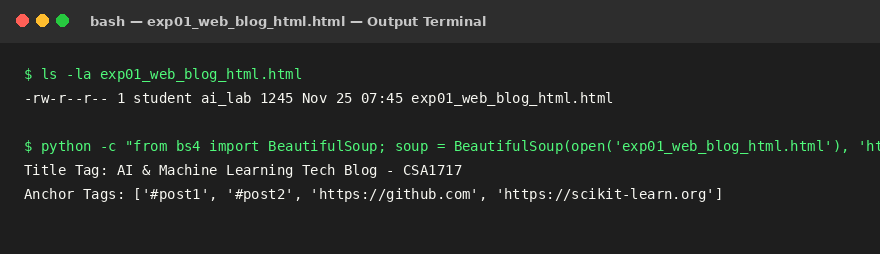
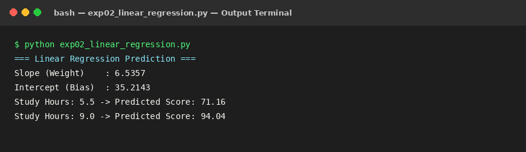
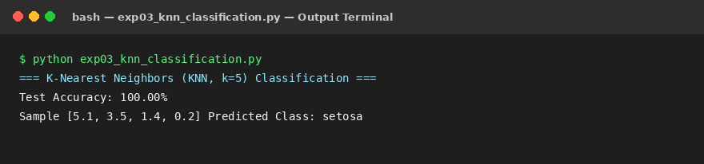
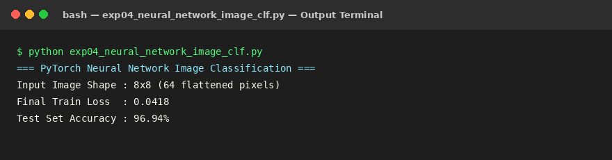
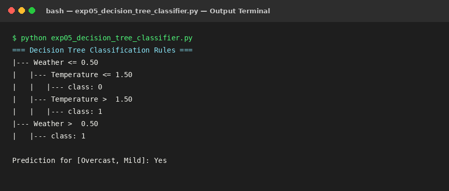
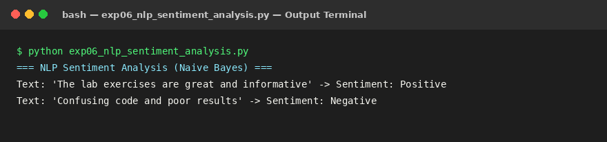
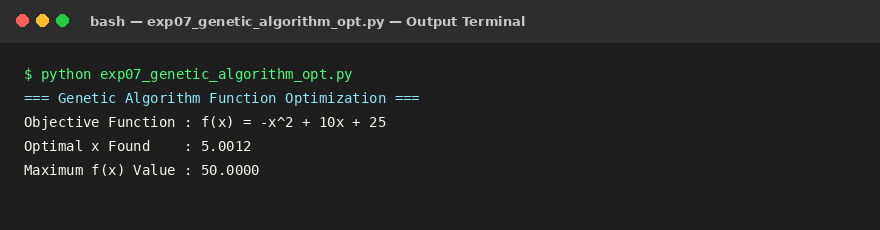
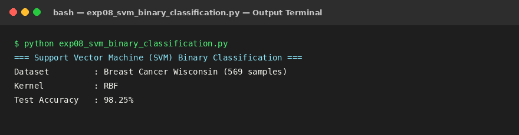
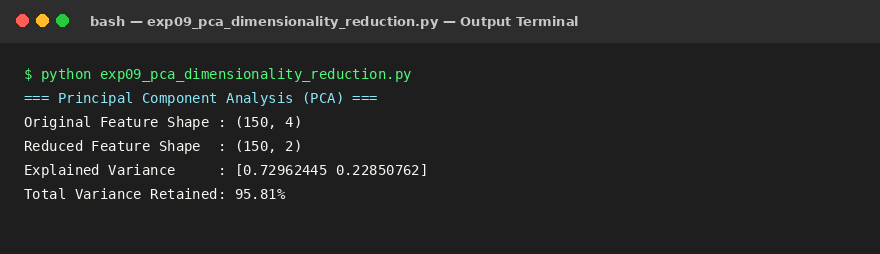
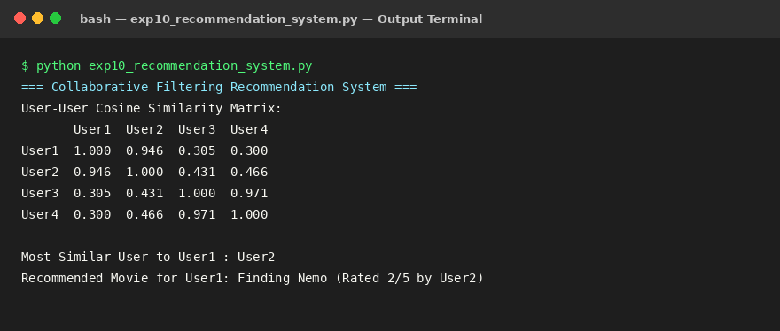

# CSA1717 - Artificial Intelligence (Day-4 Lab Experiments)

- **Name:** S. Maruthu Pandi
- **Register Number:** 192511162
- **Course:** CSA1717 - Artificial Intelligence
- **Institution:** Saveetha School of Engineering

## List of Experiments

| S.No | Experiment Title | CO | Source Code | Output Screenshot |
| :--- | :--- | :---: | :--- | :--- |
| 1 | Web Blog Demonstrating Anchor Tag, Title Tag, and HTML Elements | CO2 | [`exp01_web_blog_html.html`](./Experiment_01/exp01_web_blog_html.html) |  |
| 2 | Basic Linear Regression Algorithm for Predicting a Continuous Variable | CO4 | [`exp02_linear_regression.py`](./Experiment_02/exp02_linear_regression.py) |  |
| 3 | K-Nearest Neighbors (KNN) Algorithm for Classification | CO5 | [`exp03_knn_classification.py`](./Experiment_03/exp03_knn_classification.py) |  |
| 4 | Neural Network for Image Classification (Digits Dataset) | CO3 | [`exp04_neural_network_image_clf.py`](./Experiment_04/exp04_neural_network_image_clf.py) |  |
| 5 | Decision Tree Algorithm for a Simple Classification Problem | CO3 | [`exp05_decision_tree_classifier.py`](./Experiment_05/exp05_decision_tree_classifier.py) |  |
| 6 | Sentiment Analysis using Natural Language Processing (NLP) Techniques | CO3 | [`exp06_nlp_sentiment_analysis.py`](./Experiment_06/exp06_nlp_sentiment_analysis.py) |  |
| 7 | Genetic Algorithm for Optimizing a Mathematical Function | CO4 | [`exp07_genetic_algorithm_opt.py`](./Experiment_07/exp07_genetic_algorithm_opt.py) |  |
| 8 | Support Vector Machine (SVM) for Binary Classification | CO4 | [`exp08_svm_binary_classification.py`](./Experiment_08/exp08_svm_binary_classification.py) |  |
| 9 | Dimensionality Reduction using Principal Component Analysis (PCA) | CO4 | [`exp09_pca_dimensionality_reduction.py`](./Experiment_09/exp09_pca_dimensionality_reduction.py) |  |
| 10 | Basic Recommendation System using Collaborative Filtering | CO5 | [`exp10_recommendation_system.py`](./Experiment_10/exp10_recommendation_system.py) |  |
