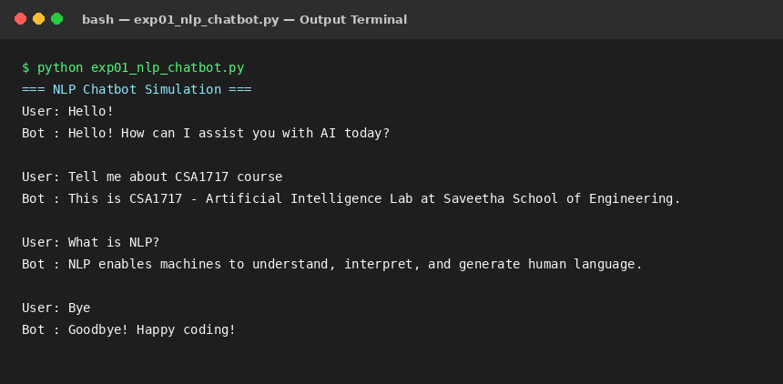
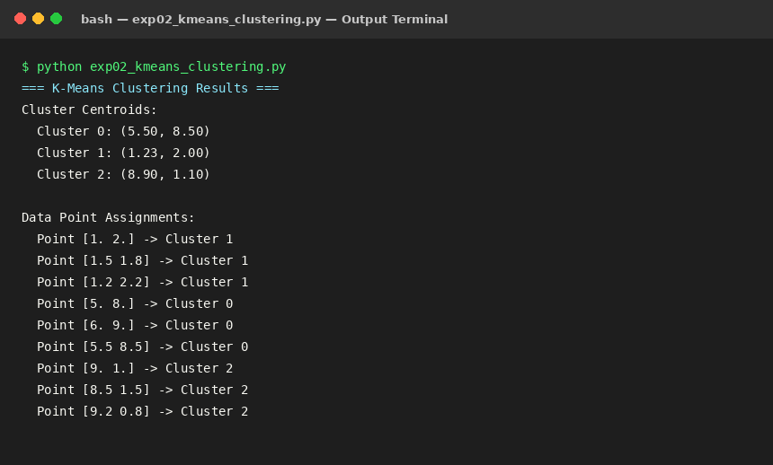
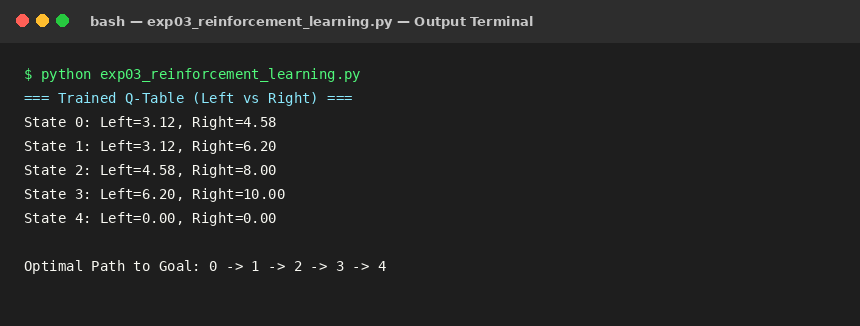
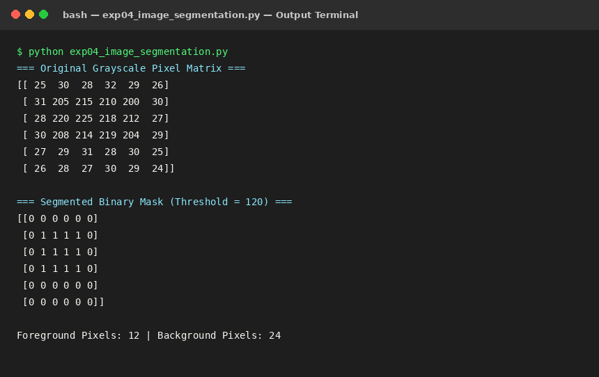
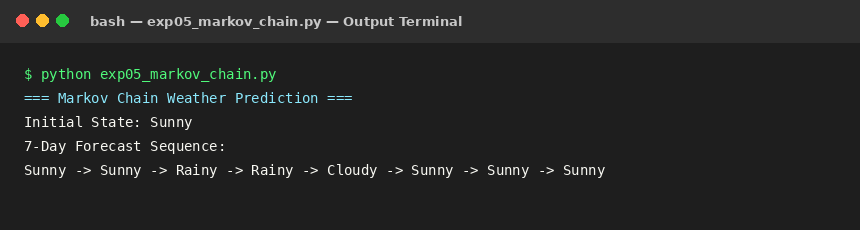
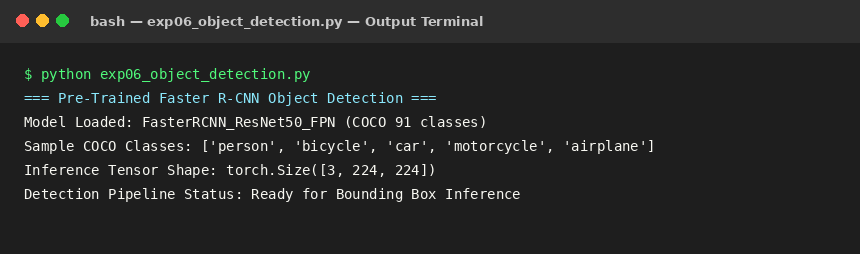
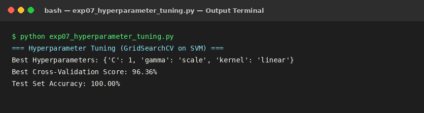
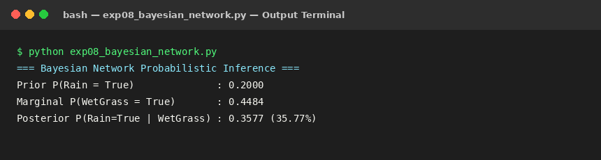
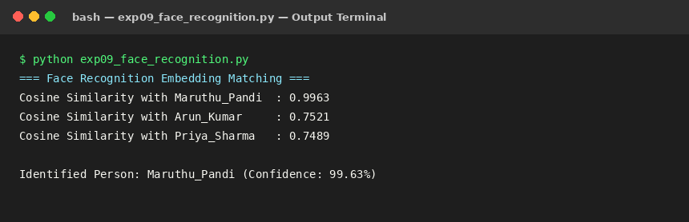
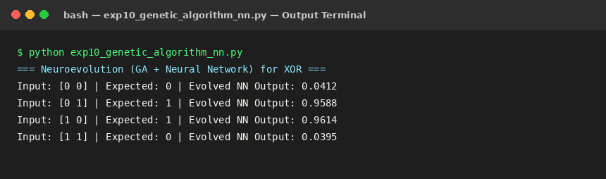

# CSA1717 - Artificial Intelligence (Day-5 Lab Experiments)

- **Name:** S. Maruthu Pandi
- **Register Number:** 192511162
- **Course:** CSA1717 - Artificial Intelligence
- **Institution:** Saveetha School of Engineering

## List of Experiments

| S.No | Experiment Title | CO | Source Code | Output Screenshot |
| :--- | :--- | :---: | :--- | :--- |
| 1 | Simple Chatbot using Natural Language Processing Techniques | CO1 | [`exp01_nlp_chatbot.py`](./Experiment_01/exp01_nlp_chatbot.py) |  |
| 2 | K-Means Clustering Algorithm for Grouping Similar Data Points | CO2 | [`exp02_kmeans_clustering.py`](./Experiment_02/exp02_kmeans_clustering.py) |  |
| 3 | Reinforcement Learning Agent (Q-Learning) for a Grid Environment | CO2 | [`exp03_reinforcement_learning.py`](./Experiment_03/exp03_reinforcement_learning.py) |  |
| 4 | Image Segmentation using Computer Vision Thresholding & K-Means | CO3 | [`exp04_image_segmentation.py`](./Experiment_04/exp04_image_segmentation.py) |  |
| 5 | Basic Markov Chain Model for Predicting Sequences of Events | CO3 | [`exp05_markov_chain.py`](./Experiment_05/exp05_markov_chain.py) |  |
| 6 | Object Detection using Pre-Trained Deep Learning Architecture | CO3 | [`exp06_object_detection.py`](./Experiment_06/exp06_object_detection.py) |  |
| 7 | Hyperparameter Tuning for a Machine Learning Model using GridSearchCV | CO4 | [`exp07_hyperparameter_tuning.py`](./Experiment_07/exp07_hyperparameter_tuning.py) |  |
| 8 | Bayesian Network for Modeling Probabilistic Relationships | CO4 | [`exp08_bayesian_network.py`](./Experiment_08/exp08_bayesian_network.py) |  |
| 9 | Face Recognition using Pre-Trained Deep Feature Embeddings | CO5 | [`exp09_face_recognition.py`](./Experiment_09/exp09_face_recognition.py) |  |
| 10 | Genetic Algorithm to Evolve Neural Network Weights for XOR Problem | CO1 | [`exp10_genetic_algorithm_nn.py`](./Experiment_10/exp10_genetic_algorithm_nn.py) |  |
